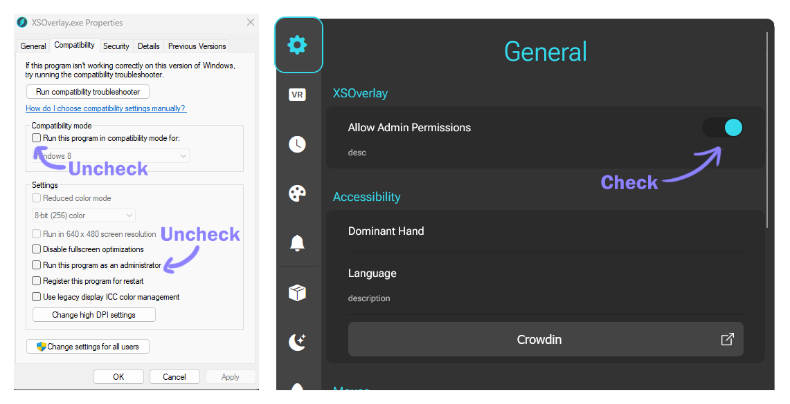
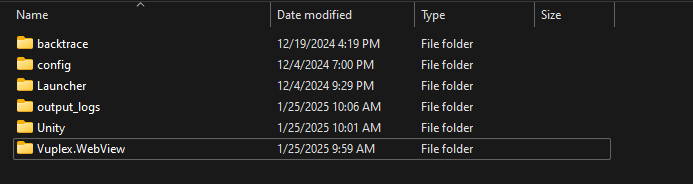

import { Callout } from 'nextra/components'

# Troubleshooting

This page covers common issues users run into with XSOverlay, such as:

- XSOverlay opens briefly but then closes
- XSOverlay is not displaying in game
- XSOverlay is white or not displaying information
- Broken interactivity in rare cases

If your issue isn't covered here, or you need more help, create an issue on [GitHub](https://github.com/Xiexe/XSOverlay-Issue-Tracker/issues/new?assignees=&labels=bug&template=bug_report.md&title=) or join the [Discord](https://discord.gg/WZm9H2BJU6) and ask for help in the #bug-reports channel. Include your latest [log file](#log-files).

## Log files

XSOverlay writes a log file each time it runs:

```
%USERPROFILE%\AppData\LocalLow\Xiexe\XSOverlay\output_logs\output_log_[DATE]_[TIME].txt
```

Every [notification](/Developer/websocket-api/commands/notifications#sendnotification) is logged, along with any formatting errors, which makes the log useful when building apps that use the API.

## Administrator Rights

Older versions of XSOverlay had to be run as administrator through the Windows compatibility menu. This is no longer required, as XSOverlay now has this built in. If this is your first time using XSOverlay, this likely won't affect you.

1. Navigate to your XSOverlay installation directory (typically in your Steam folder) and find `XSOverlay.exe`.
2. Open its properties and make sure these options are **not** checked (see the image below):
    - `Run this program as an administrator`
    - `Run this program in compatibility mode for`
3. Click `Apply` and then `OK` to save your changes.
4. Restart XSOverlay.
5. In XSOverlay, open Settings and go to the General tab.
6. Turn on [Allow Admin Permissions](/settings/general#allow-admin-permissions).
7. Restart XSOverlay.
8. Accept the UAC prompt. This creates the services XSOverlay needs to run as administrator without further UAC prompts.



## Antivirus & Firewall

Antivirus software sometimes flags XSOverlay as a false positive and blocks part or all of the application. Configuration menus differ between products, so refer to your antivirus or firewall's documentation for the exact steps.

Add exceptions for both executables and the ports they use. If you've [changed the ports](#port-bindings), add exceptions for your ports instead.

| Executable | Location | Ports |
| --- | --- | --- |
| `XSOverlay.exe` | Root of the installation directory | `UDP` `42069` for the [UDP Notification API](/Developer/legacy-udp-notifications), `TCP` `42070` for the [WebSocket API](/Developer/websocket-api/overview), `TCP` `42071` for its UI |
| `XSOverlay Media Manager.exe` | `[XSOverlay install]/XSOverlay_Data/StreamingAssets/Modules/Media Manager/` | Connects to `TCP` `42070` |

The installation directory is typically in your Steam folder.

## Port Bindings

If XSOverlay can't bind to its ports, change them in `ExternalMessageAPIConfig.json` in `[XSOverlay install]/XSOverlay_Data/StreamingAssets/Plugins/Config/`.

| Option | Description | Default Value |
| --- | --- | --- |
| `WebSocketPort` | The port XSOverlay listens for WebSocket messages on. | `42070` |

XSOverlay uses both `WebSocketPort` and `WebSocketPort + 1`. For example, if set to `40000`, XSOverlay uses ports `40000` and `40001`, so make sure both are free.

<Callout>
Use a port number between `20000` and `49150`. Ports outside this range may conflict with ports reserved by your operating system or other services.
</Callout>

## Vuplex.WebView Cache

In rare cases, some interfaces or interactions break because of the Vuplex WebView cache. Clearing the cache fixes this.

1. Close XSOverlay.
2. Open the following directory in File Explorer:
    ```
    %USERPROFILE%\AppData\LocalLow\Xiexe\XSOverlay\
    ```
3. Delete the `Vuplex.WebView` directory.
4. Launch XSOverlay.


